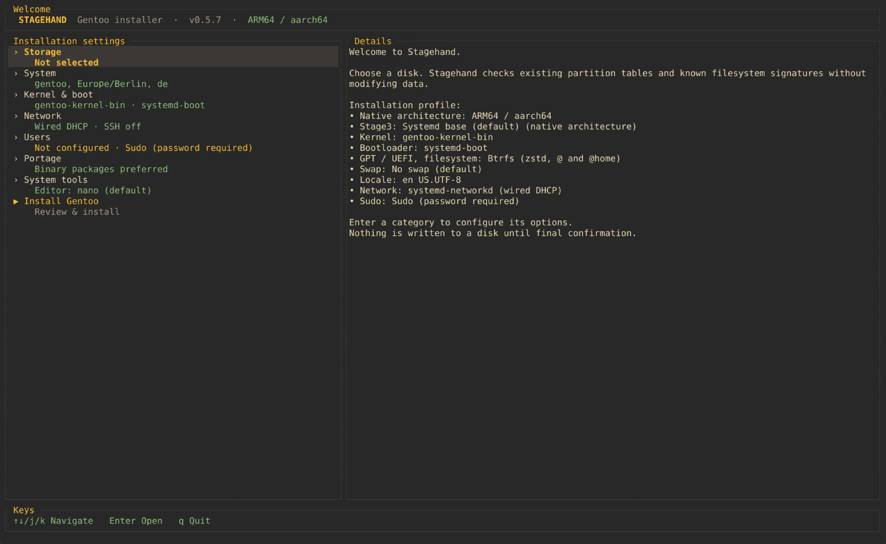

<p align="center">
  
</p>

<h1 align="center">Stagehand</h1>
<p align="center"><strong>Gentoo, one step at a time.</strong></p>

A keyboard-first, guided **Gentoo Linux installer written in Rust**. Inspired by
[archinstall](https://github.com/archlinux/archinstall) and [YaST](https://yast.opensuse.org/),
Stagehand lets you configure an installation in a clean terminal interface,
review every decision, and install only after explicit confirmation.

> **Early development (v0.5.7).** The installer has not yet passed an end-to-end
> UEFI VM boot test. **Do not run it against a disk containing valuable data.**
> Use a disposable virtual machine until the installation and boot path are validated.

## One screen, all the important choices



*Live screenshot of Stagehand running on ARM64 / aarch64. Configured defaults appear in Gruvbox green; required settings that are still missing are highlighted in amber.*

The main menu is organized into **Storage**, **System**, **Kernel & boot**, **Network**, **Users**, **Portage** and **System tools** submenus, plus a separate final installation action.

The interface uses **ratatui + crossterm** with a compact Gruvbox-inspired color
scheme. It runs entirely in the terminal and does not require Python, Ansible,
a graphical environment, or a desktop environment.

### What you configure

- Target disk with a non-destructive inspection of partition tables and filesystem signatures. Existing data is clearly marked; mounted, read-only and removable disks are unavailable.
- Hostname, timezone, console keymap, UTF-8 locale and standard or desktop systemd Stage3.
- Kernel package and bootloader in the **Kernel & boot** submenu.
- Filesystem: Btrfs (default) or ext4; optional 4 GiB swap partition (minimum 16 GiB target).
- Portage: prefer binary packages (default) or compile from source; automatic, 2-job or 4-job MAKEOPTS.
- Networking: systemd-networkd with wired DHCP (default) or NetworkManager with Ethernet/Wi-Fi support.
- System tools: optional cronie daemon and a preferred text editor (none, nano or vim).
- Local user and root credentials, with password confirmation. Sudo is optional: disabled, requires the user's password (default), or passwordless.
- Optional SSH with public-key authentication (password SSH and root SSH disabled).
- Final installation review and a mandatory typed `ERASE /dev/...` confirmation.

### What Stagehand installs

The initial installation profile follows the base system from
[dme86/gentoo-ansible](https://github.com/dme86/gentoo-ansible):

| Component | Default |
| --- | --- |
| Architecture | Native amd64 or arm64 |
| Init | systemd; base Stage3 (default) or desktop Stage3 |
| Partitioning | GPT, 512 MiB FAT32 ESP, optional 4 GiB swap, remaining space for root |
| Subvolumes | `@` mounted at `/`, `@home` at `/home` |
| Filesystem | Btrfs with zstd compression (default) or ext4 |
| Kernel | `gentoo-kernel-bin` (default) or `gentoo-kernel` (source build) |
| Bootloader | systemd-boot (default) or GRUB, UEFI |
| Networking | systemd-networkd with wired DHCP (default) or NetworkManager |
| Package management | Portage, binary packages preferred; optional source builds; configurable MAKEOPTS |
| Console and locale | Configurable keymap; en_US.UTF-8 (default), de_DE.UTF-8 or C.UTF-8 |

Stagehand detects its **native live-system architecture** at runtime (`x86_64` → `amd64`, `aarch64` → `arm64`) and downloads only the selected base or desktop systemd stage3. No Gentoo ISO download is necessary: boot a Linux live system first. Cross-architecture installations are intentionally unsupported.

The official systemd stage3 is downloaded and **SHA-256 verified before any disk
writes occur**. Installation logs are written to `/tmp/stagehand-install.log`,
with credential input excluded from the log. Failures trigger a best-effort
unmount of the installation tree.

Anvil, rst, greetd and other personal desktop tooling from
`gentoo-ansible/post_install.yml` are **not** installed in this first version.
The base installer is intentionally independent of that configuration.

## Build and try it

Build on a Linux machine of the **same architecture** as the intended Gentoo
installation environment:

```sh
git clone https://github.com/dme86/Stagehand.git
cd Stagehand
cargo build --release
sudo ./target/release/stagehand
```

The Gentoo minimal ISO does not necessarily include the Rust toolchain. Build
the binary on a separate Linux host and copy it into the **Gentoo live
environment**, or prepare a custom live image. A macOS-native binary is not
supported, even on an ARM Mac.

The live environment needs UEFI boot, a working network connection, and:
`lsblk`, `swapon`, `parted`, `udevadm`, `mkfs.vfat`, `mkfs.btrfs`,
`btrfs`, `mount`, `umount`, `chroot`, `tar`, `curl`, `wipefs`, and `sync`.
`mkfs.ext4` and `mkswap` are additionally required when those options are selected.
The chosen disk must have at least 8 GiB; a larger disk is strongly
recommended for Portage. Stagehand refuses mounted, read-only and removable target disks, and checks active swap.
Its disk inspection distinguishes **known signatures / partitions**, **no known signatures**, and **unknown**. No-signature detection does not guarantee an empty disk; full-disk erasure always requires explicit confirmation.

**First try Stagehand inside a disposable UEFI QEMU/UTM virtual machine**, with
a dedicated, empty virtual disk. Do not boot your everyday Linux system and
point the installer at an attached physical drive.

## Architecture and installer media

Stagehand does **not** download or create a live ISO. It is a Linux binary designed to run *inside an already booted live environment* such as the official Gentoo minimal ISO. Architecture detection selects the correct **Stage3 archive**, not a boot image. An optional custom Stagehand bootable image may be provided in a future release.


## Installation settings

The left-hand main menu deliberately stays small:

- **Storage** — installation disk, Btrfs/ext4 filesystem and optional 4 GiB swap.
- **System** — hostname, timezone, keymap, UTF-8 locale, base/desktop Stage3.
- **Kernel & boot** — `gentoo-kernel-bin` or `gentoo-kernel`; systemd-boot or GRUB (UEFI).
- **Network** — systemd-networkd or NetworkManager, optional key-only SSH and public key.
- **Users** — local username/password, root password, and sudo mode (disabled, password, passwordless).
- **Portage** — binary packages preferred or source builds; automatic, two or four parallel build jobs.
- **System tools** — nano/vim/no additional editor, optional cronie.
- **Install Gentoo** — full summary and typed `ERASE /dev/...` confirmation.

Selecting `gentoo-kernel` builds the distribution kernel from source and can be slower, while `gentoo-kernel-bin` is recommended for a first installation. Stagehand configures `sys-kernel/installkernel` USE flags to match the chosen bootloader and verifies boot artifacts before reporting success.

## Keyboard controls

| Key | Action |
| --- | --- |
| `↑` / `↓`, `j` / `k` | Navigate settings |
| `Enter` | Select, edit, or save |
| `Esc` | Return to main menu |
| `r` | Refresh disk list |
| `Esc` | Return to parent submenu |
| `q` | Quit from main menu |
| `L` | Switch between phase progress and live logs during/after installation |
| `q` / `Esc` (installing) | Detach the TUI **without stopping the installer** |
| `Enter` (finished/failed) | Return to installer setup |

Once you confirm the full-disk erase, Stagehand starts a **detached installer worker**.
The TUI only displays its progress, and pressing `L` toggles between completed
installation phases and the live log. Closing Stagehand with `q` or `Esc`
**does not stop the worker**. Run Stagehand again in the *same live environment*
to reattach to the current worker, or inspect its final success/failure result.

The progress gauge counts **completed installation phases out of 12**. A source
kernel compilation may take a long time, so Stagehand does not invent a
time-based percentage. Failed commands and cleanup errors remain available
in the log even after the TUI exits. The worker exits after installation
success or failure; it is not a permanent daemon.

## Stable system identity and Boot Loader Specification names

Stagehand prepares **two independent identities during installation**:

- A cryptographically random 128-bit `/etc/machine-id` in lowercase
  hexadecimal. It is generated once for the target system, **not copied
  from the Gentoo live ISO**, and persists across reboots.
- An independent random 96-bit public token, prefixed with `gentoo-`,
  for systemd-boot. This avoids exposing the private machine ID through
  filenames on the unencrypted EFI system partition.

Before the kernel is emerged, Stagehand writes
`/etc/kernel/entry-token` and `/etc/kernel/install.conf` with
`layout=bls`. `kernel-install` then generates entries named
`<token>-<kernel-version>.conf`. At bootloader setup,
`bootctl install --entry-token=literal:<token>` uses the same value,
and `loader.conf` selects `default <token>-*`.

The validator rejects a missing/invalid machine ID, a changed entry token,
an unmatched default, or missing BLS entries. Subsequent kernel upgrades
read the unchanged `/etc/kernel/entry-token`, so entries keep their
names even after a reboot. GRUB also receives an independent stable
machine ID, but does not require a systemd-boot entry token.

**First-boot behavior:** because the machine ID is initialized during
installation, systemd does not treat the first boot as a
`ConditionFirstBoot=yes` boot. This is intentional for an installer that
already configures users and services. For a reusable generic image,
a blank machine ID would instead be appropriate.

See the systemd
[machine-id](https://www.freedesktop.org/software/systemd/man/latest/machine-id.html),
[kernel-install](https://www.freedesktop.org/software/systemd/man/latest/kernel-install.html)
and [bootctl](https://www.freedesktop.org/software/systemd/man/latest/bootctl.html)
documentation.

## Bootloader verification (v0.5.7)

Stagehand now verifies the **installed EFI boot chain** after setting up
the bootloader, rather than treating the existence of an entry file as proof.

- **Both bootloaders:** the UEFI removable-media loader must exist at
  `/boot/EFI/BOOT/BOOTX64.EFI` (AMD64) or `BOOTAA64.EFI` (ARM64).
  Stagehand checks that it is a real PE/COFF binary for the native
  architecture. systemd-boot must also have its loader under
  `/boot/EFI/systemd/`.
- **systemd-boot:** before emerging the kernel, Stagehand creates a
  **unique, stable** machine ID for the installed system and a separate
  `gentoo-<random>` entry token in `/etc/kernel/entry-token`, with
  `layout=bls` in `/etc/kernel/install.conf`. The loader default
  is calculated from that exact token (`default <token>-*`) and used
  again by `bootctl`. This avoids naming collisions while keeping
  the private machine ID off the ESP. After `bootctl install`, Stagehand
  verifies every matching BLS entry's kernel, initrd(s) and kernel
  parameters against `/etc/kernel/cmdline`, and calls `bootctl list`
  inside the target chroot.
- **GRUB:** after `grub-mkconfig`, the installer runs
  `grub-script-check`, then inspects the default Linux menu entry.
  The referenced kernel and matching-version initramfs must exist on
  the EFI partition. Its `root=UUID=...` must match the real root
  partition UUID read using `blkid` (or it must use
  `root=LABEL=ROOT`). Btrfs additionally requires
  `rootflags=subvol=@`.

Missing files, corrupt EFI signatures, mismatched architectures, incorrect
root parameters, unsafe EFI paths, or wrong boot defaults now **fail the
installation explicitly**. Tests exercise valid and invalid files,
boot entries and UUIDs without touching real disks.

**Limitations:** These are consistency and format checks, not a
full firmware simulation, Secure Boot signature verification, or
proof that a hardware-specific initramfs successfully boots. A
complete QEMU/OVMF install-and-reboot test is still required.

## Sudo permissions and Gruvbox selection colors (v0.5.7)

Configured settings and active defaults are now displayed in a soft
**Gruvbox green** (`#8ec07c`) in the main menu and individual submenus.
Required but unconfigured values such as the target disk or user credentials
remain amber. The optional SSH public key stays muted when SSH is disabled,
and becomes amber only if SSH is enabled without a key. Selection highlights
preserve the status colors rather than overriding them with amber.

The **Users** submenu now exposes a clear `Sudo access` selection:

| Choice | User group | Portage | Installed sudoers policy |
| --- | --- | --- | --- |
| No sudo | Not added to `wheel` | No `app-admin/sudo` | No Stagehand sudoers drop-in |
| Sudo with password **(default)** | Added to `wheel` | `app-admin/sudo` | `%wheel ALL=(ALL:ALL) ALL` |
| Sudo without password | Added to `wheel` | `app-admin/sudo` | `%wheel ALL=(ALL:ALL) NOPASSWD: ALL` |

If sudo is enabled, Stagehand installs the package through Portage **before**
writing `/etc/sudoers.d/stagehand-wheel`. The drop-in uses file mode `0440`,
the main sudoers file is made to include the drop-in directory if needed,
and both configurations are checked with `visudo -cf` in the Gentoo chroot.
Any syntax error aborts installation.

With sudo disabled, Stagehand does not install sudo or create a sudoers
policy for this user. Root retains its separate password. With passwordless
sudo, the user can execute commands as root **without authentication**;
choose this only when the environment and account are trusted.

## Stable filesystem UUIDs for root, EFI and swap (v0.5.7)

Stagehand no longer uses `LABEL=ROOT`, `LABEL=EFI`, or `LABEL=SWAP`
as installed filesystem identifiers. After formatting the target disk,
it uses `blkid --probe --no-part-details` **on each concrete partition
device** to read the newly created filesystem UUID and type, bypassing
libblkid's device-cache. It rejects an unrecognized filesystem type,
missing/malformed UUID and any duplicate identifier before extracting
Stage3 or writing the installed configuration.

- **Btrfs:** `fstab` mounts `/` and `/home` using the **same root UUID**
  with their respective `subvol=@` and `subvol=@home` mount options.
  The kernel command line uses `root=UUID=<root-uuid>` and
  `rootflags=subvol=@`.
- **ext4:** `fstab` uses the ext4 root UUID and kernel arguments include
  `root=UUID=<root-uuid> rootfstype=ext4` without Btrfs flags.
- **EFI:** `/boot` mounts by its FAT32 UUID rather than a generic label.
- **Swap:** when enabled, `fstab` uses the specific swap UUID created by
  `mkswap`. No swap entry is generated otherwise.

UUIDs are checked for consistency after configuration and freshly
re-probed before bootloader installation. For systemd-boot, Stagehand's
BLS entry validator must find the exact installed root UUID in
`/etc/kernel/cmdline` and the installed entry. For GRUB, the validator
must match the kernel's `root=UUID=` against the same value. Using
`LABEL=ROOT` or any other UUID causes installation validation to fail.

This avoids accidental booting or mounting a different drive that
happens to be labelled `ROOT`, including attached disks. It does not
replace the pending end-to-end UEFI/QEMU first-boot test.

References: [Gentoo AMD64 Handbook – filesystem and partition UUIDs](https://wiki.gentoo.org/wiki/Handbook:AMD64)
and [util-linux blkid](https://man7.org/linux/man-pages/man8/blkid.8.html).

## Btrfs filesystem tools before kernel installation

For a Btrfs root filesystem, Stagehand runs **a dedicated Portage transaction**
to install `sys-fs/btrfs-progs` **before** installing Dracut and the kernel.
The installation then executes `/usr/bin/btrfs --version` **inside the new
Gentoo chroot**, not in the live ISO. If this fails, Stagehand aborts before
`gentoo-kernel` or `gentoo-kernel-bin` can generate an initramfs.

The explicit order is: bootloader prerequisites → Btrfs tools (Btrfs only)
→ Dracut and Linux firmware → verify target Btrfs CLI (Btrfs only)
→ Gentoo kernel → verify initramfs.

For **ext4**, Stagehand neither installs nor checks Btrfs tools. Unit tests
assert the ordering for both bootloaders and both supported root filesystems.
This safeguards the package-install sequence but is not a substitute for
the pending QEMU/OVMF first-boot integration test.

## Safe initramfs creation from the live ISO

Before installing any kernel, Stagehand writes
`/etc/dracut.conf.d/90-stagehand.conf` **into the target Stage3**, not the
live ISO, with the following explicit settings:

```sh
hostonly="no"
hostonly_cmdline="no"
```

Dracut runs **inside the prepared Gentoo chroot** through the
`sys-kernel/installkernel[dracut]` hook when `gentoo-kernel` or
`gentoo-kernel-bin` is emerged. The generic image avoids depending on
the installer ISO's hardware, and no live-ISO `root=` is embedded.
The correct root is provided by the installed bootloader configuration.

Stagehand installs Dracut, Linux firmware, and (for Btrfs roots)
`btrfs-progs` **before the kernel**. It disables optional generic UKIs
to keep the conventional Dracut initramfs path deterministic.

After the kernel emerges, the installer checks the new files:

- **systemd-boot:** validates the BLS entry under
  `/boot/loader/entries/`, its referenced Linux image and initrd.
- **GRUB:** validates `/boot/initramfs-<kernel-version>.img` and the
  matching `vmlinuz-` or `kernel-` image.

Missing or implausibly small files are rejected; then
`lsinitrd -m <initramfs>` runs inside the Gentoo chroot to confirm
that Dracut can inspect the generated image. A failed check prevents
Stagehand from reporting a successful installation.

A readable initramfs is not proof that the system can boot on every
machine. An end-to-end UEFI installation/reboot test is still necessary.

References: [Gentoo Dracut](https://wiki.gentoo.org/wiki/Dracut),
[Installkernel](https://wiki.gentoo.org/wiki/Installkernel),
[2025 Dracut hostonly change](https://www.gentoo.org/support/news-items/2025-02-03-dracut-hostonly.html)
and [2026 hostonly_cmdline change](https://www.gentoo.org/support/news-items/2026-05-08-dracut-hostonly-cmdline.html).

## Detached installer worker

The installer is split into two parts inside a **single Rust executable**:

- **TUI (ratatui):** collects installation choices, checks confirmation, shows
  completed phases, and reads worker status and logs. It does not partition or
  build packages itself.
- **Worker process:** launched after the typed ERASE confirmation, in a separate
  Linux session. It survives closing the TUI, performs installation commands,
  and writes a redacted status snapshot after each phase change.

The configuration, including credentials, is passed **only over a bounded
anonymous stdin pipe** into the worker. It is never placed into command-line
arguments, environment variables, status JSON, or installation logs. The TUI
clears its credential strings after successfully launching the worker.

Worker runtime files:

| File | Purpose |
| --- | --- |
| /run/stagehand/status.json | Atomic status snapshot: PID, state, phase, number completed, message or error |
| /run/stagehand/active.lock | Exclusive worker lock against concurrent installation |
| /tmp/stagehand-install.log | Full command output, credential stdin redacted |

The worker status directory is accessible only to root. Runtime status is
**ephemeral** and persists only for the current live boot. A forcibly killed
worker may leave the lock in place: investigate mounts, mounted chroot
filesystems and the installation log before manually clearing the lock. A new
installation never automatically resumes a partially written filesystem.

### Start, detach, reattach

1. Boot the Gentoo live environment and run Stagehand as root.
2. Complete the installer choices and confirm the selected disk with ERASE.
3. Watch the phase bar; press L to inspect live command output.
4. Optionally press q or Esc to leave the TUI; the worker continues.
5. Run Stagehand again from the same live system to reattach.

Note: a successful Rust build and unit tests do **not** validate the complete
Gentoo installation/boot process. Only use disposable VM disks until the full
UEFI install and reboot workflow is verified.

## Current scope and next milestones

This is a **first implementation**, not a fully validated general-purpose
Gentoo installer. In particular:

- UEFI only; no BIOS/legacy boot.
- Whole-disk installs only; no partition preservation, LUKS or dual-boot.
- Wired DHCP only; Wi-Fi and advanced network setup are not yet configured.
- systemd/UEFI only; Stage3 flavor, Btrfs/ext4, kernel, swap, network manager and UEFI bootloader are selectable.
- No automated integration test booting the resulting disk yet.
- Re-running the installation is destructive; no resume support.
- SHA-256 validation protects downloaded archives against accidental corruption,
  but signed Gentoo OpenPGP verification is not yet implemented.
- Kernel and bootloader combinations need to be verified on real UEFI VMs.

Roadmap: automated QEMU boot testing, signed artifact verification, additional
init profiles, advanced locale and network configuration, package
selection, disk encryption and optional Anvil + rst desktop integration.

## Comparison with gentoo-ansible

The base installer follows the systemd/UEFI profile in
[gentoo-ansible/install.yml](https://github.com/dme86/gentoo-ansible/blob/main/install.yml).
Stagehand additionally configures `/etc/hosts`, a fresh, preinitialized `/etc/machine-id`,
`locale.gen`, `locale.conf` and the selected UTF-8 locale using `locale-gen`.
The Gentoo Stage3's existing Portage profile and binhost settings are retained.

The Ansible installer is dedicated to a QEMU guest and enables key-only **root SSH**
for remote VM administration. Stagehand intentionally requires explicit disk
selection and uses key-only SSH for the named administrator; root SSH is disabled.

The separate `post_install.yml` installs a personalized Anvil/rst/greetd graphical
desktop and is not a requirement for a functional Gentoo base installation.

OpenRC, custom Portage profiles/USE flags, advanced partitioning, LUKS,
Secure Boot, Wi-Fi, static IP configuration and opt-in desktop installation remain
outside the supported profile. Rust CI is not a substitute for a real boot
test: use a disposable UEFI QEMU disk before trusting a new configuration.


## Gentoo Handbook coverage

Stagehand v0.5.7 incorporates additional choices from the official
[Gentoo AMD64 Handbook](https://wiki.gentoo.org/wiki/Handbook:AMD64).
Both AMD64 and ARM64 offer standard and desktop systemd Stage3 archives; desktop
Stage3 includes extra development tools, **not a preinstalled graphical environment**.
Stagehand downloads and verifies the selected archive before modifying the disk.

For network management, choose the default `systemd-networkd` with wired DHCP,
or `NetworkManager` for Ethernet/Wi-Fi management. NetworkManager installs with
Wi-Fi support, but **does not connect to a wireless SSID during installation**:
configure wireless credentials after the first boot. An active wired network is
required by the installer itself.

Portage can keep automatic `MAKEOPTS` (the recommended setting) or request
`-j2` / `-j4`. The Handbook suggests allowing approximately 2 GiB RAM per
simultaneous build job. The separate System tools submenu offers the optional
`cronie` service and nano/vim editors. Systemd already supplies journald and
timer units, so no separate logging daemon or scheduler is required by default.

For now the installer remains a guided **systemd/UEFI, whole-disk** installer.
The Handbook also covers OpenRC, multilib/no-multilib Stage3, custom Gentoo
profiles/USE flags, Legacy BIOS boot, detailed partitioning, Secure Boot and
manual kernel compilation. Those need dedicated installation workflows and
integration testing rather than exposing settings that Stagehand cannot reliably
apply yet. **Rust CI validates code, not successful Gentoo boot.**

## Installation sequence audit

Stagehand's actual order of operations is documented in
[docs/INSTALLATION_SEQUENCE.md](docs/INSTALLATION_SEQUENCE.md). The sequence
is cross-checked against the official Gentoo AMD64 Handbook and the
`gentoo-ansible/install.yml` reference: Stage3 and Portage configuration
precede chroot, virtual filesystems and resolver are verified before emerging
packages, `env-update` and `/etc/profile` are applied inside Gentoo, and
`installkernel` is installed before the selected distribution kernel.

GRUB's Btrfs root subvolume flags and an actual kernel boot entry are verified
before Stagehand reports a successful installation. The tests validate the
sequence non-destructively; a full bootable VM installation remains outstanding.

## Development

```sh
cargo fmt --check
cargo test
cargo clippy --all-targets -- -D warnings
cargo build --release
```

The installer uses separate modules for configuration validation, block-device
discovery, installation execution and terminal UI. Privileged operations happen
only after confirmation; command execution passes arguments directly to
processes rather than interpolating settings into shell scripts.

## Branding

The official Stagehand logo is included as a scalable SVG with a transparent
background in [`assets/logo.svg`](assets/logo.svg). The violet Gentoo-inspired
emblem, download symbol and wordmark follow the approved Stagehand artwork.

## License

MIT.
